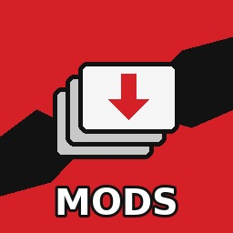

<div align="center">

[](README.md)
[](README.es.md)



# Compendium

*Un gestor de mods para juegos Persona en Switch, con el nombre del Compendio, donde los juegos guardan tus Personas para volver a invocarlas.*

**Instala y gestiona mods de juegos Persona en una Nintendo Switch con firmware personalizado, desde la propia consola. Sin PC.**<br>
Explora GameBanana, descarga un mod y la app lo integra en los archivos del juego: arma en la propia Switch el
archivo `.CPK` que lee Persona 5 Royal.

[](../../releases)


[](LICENSE)
[](https://ko-fi.com/santibros)

[Instalación](#cómo-instalar) · [Uso](#uso) · [Formatos de mods](#qué-mods-funcionan) · [Cómo cargan los mods](#cómo-llegan-los-mods-al-juego) · [Solución de problemas](#solución-de-problemas) · [Compilar](#compilar) · [Créditos](#créditos)

</div>

> [!IMPORTANT]
> **No se incluye ningún archivo del juego**, ni en este repositorio ni en las versiones publicadas. Necesitas tu propia
> copia del juego. Los mods pertenecen a sus autores y se descargan de donde ellos los publican.

## Juegos

| Juego | Estado |
|---|---|
| **Persona 5 Royal** | ✅ Compatible (esta versión) |
| Persona 4 Golden, Persona 3 Portable, Persona 5 Strikers, Persona 5 Tactica, Persona 4 Arena Ultimax | Más adelante |

## ⚠️ Antes de empezar

- **Úsalo bajo tu propio riesgo.** Un mod dañado o incompatible puede hacer que el juego se cierre. Haz copia de tus partidas (por ejemplo con JKSV).
- **Conectarte a internet con firmware personalizado puede hacer que Nintendo bloquee tu consola.** Usa los mods en un emuMMC y bloquea los servidores de Nintendo (por ejemplo con 90DNS).
- **Siempre puedes quitar los mods:** apágalos en My mods (Mis mods), o mantén **L** al iniciar el juego para jugar esa vez sin ningún mod.

## Funciones

- **Explora y busca en GameBanana** desde la consola: los mods de Persona 5 Royal para **Switch** y los de **PC** (cambia con L/R), con imágenes y descripciones.
- **Arma el CPK en la consola.** Tus mods se empaquetan en el `PATCH1.CPK` del juego (o en un CPK para p5rcbt), conservando los archivos propios del PATCH1 del juego.
- **Muchos formatos de mods:** paquetes de Aemulus, archivos `PATCH1.CPK` ya armados, carpetas de Atmosphère / SimpleModManager, carpetas de p5rcbt y archivos sueltos del juego ([abajo](#qué-mods-funcionan)).
- **Mods de PC adaptados:** los mods de Reloaded-II para la versión de PC (P5R Essentials) se convierten para Switch al instalarlos.
- **Orden de carga y conflictos:** cuando dos mods cambian el mismo archivo, gana el que está más arriba en Mis mods, y la app te dice qué archivos chocan.
- **Encender y apagar sin borrar:** se guarda una copia de cada mod, así que al apagar uno se vuelven a armar los archivos del juego sin él.
- **Agrega mods desde cualquier lado:** GameBanana (explorando o escribiendo el número del mod), proyectos de GitHub (su última versión), un enlace enviado desde tu celular (escaneando un código QR) o archivos copiados a `switch/Compendium/inbox`.
- **Trae tus mods de antes:** los mods guardados para **SimpleModManager** (`sd:/mods/…`) y un `PATCH1.CPK` copiado a mano se pueden agregar a la lista.
- **Compatible con p5rcbt:** instala el plugin de Skyline p5rcbt desde Ajustes y cambia sus opciones (60 FPS, el menú de ajustes de la versión de PC).
- **Cuida tus archivos:** lo que ya hubiera en la SD donde escribe la app se aparta y vuelve a su lugar cuando apagas tus mods.

## Cómo instalar

1. Descarga **`Compendium.nro`** de la [página de versiones](../../releases) (no "Source code").
2. Cópialo a `sd:/switch/Compendium/Compendium.nro`.
3. Abre el Homebrew Menu e inicia **Compendium**. Para tener toda la memoria, abre el Homebrew Menu manteniendo **R** al iniciar un juego, en vez de desde el Álbum.

Para actualizar, reemplaza el `.nro`. Tus mods y ajustes se conservan.

### Paso de una sola vez: los archivos propios del juego (recomendado)

`PATCH1.CPK` viene con la actualización del juego y trae algunos de sus archivos. Para que la app los conserve
al armar el de tus mods, deja que los lea una vez (y de nuevo después de actualizar el juego):

1. Presiona **+** para cerrar la app.
2. Mantén **L y R** e inicia Persona 5 Royal. Sigue manteniéndolos hasta que se abra el Homebrew Menu.
   (R abre el Homebrew Menu en lugar del juego; L apaga los mods en ese inicio.)
3. Abre Compendium. Lee los archivos sola y te avisa cuando termina.

También lee la lista de archivos del juego, que usa para ubicar los archivos de mods que no traen su carpeta del CPK.

## Uso

La app está en inglés por ahora; entre paréntesis va la traducción.


| Página | Qué hace |
|---|---|
| **Browse** (Explorar) | Los mods de Persona 5 Royal en GameBanana. **L/R**: mods de Switch o de PC · **Y**: cambiar el orden · **X**: buscar · **A**: instalar |
| **Search** (Buscar) | Busca por nombre o autor, o escribe el número de un mod (el final de su enlace de GameBanana) |
| **Add mods** (Agregar mods) | Archivos en `switch/Compendium/inbox`, mods de SimpleModManager, un `PATCH1.CPK` copiado a mano, un enlace desde tu celular o un número de mod |
| **My mods** (Mis mods) | Tu orden de carga (gana el de arriba). **A**: encender/apagar · **L/R**: subir/bajar · **X**: quitar |
| **Settings** (Ajustes) | Cómo se cargan los mods, los archivos propios del juego, p5rcbt, complementos en segundo plano, almacenamiento |

## Qué mods funcionan

| Cómo viene el mod | Qué hace la app |
|---|---|
| **Paquete de Aemulus** (una carpeta con `Package.xml`), el formato habitual de los mods de P5R para Switch | Sus archivos van al CPK con las rutas que tienen, como hace Aemulus |
| **Un `PATCH1.CPK` ya armado** o cualquier `.cpk` de un mod | Sus archivos se usan tal cual, combinados con tus otros mods |
| **Carpetas de Atmosphère o SimpleModManager** (`atmosphere/contents/01005CA01580E000/…`) | El CPK de adentro se combina; trucos, parches de exefs y plugins van a la SD |
| **Archivos sueltos del juego** (`BASE/…`, `EN/…`, `PATCH1/…`, el `romfs/CPK/PATCH1/…` de Aemulus, el `PATCH1.CPK_unpacked` de CriPakTools) | Se empaquetan en el CPK |
| **Carpetas de p5rcbt** (`p5r/bind/…`) | Se empaquetan en el CPK |
| **Mods de PC para Reloaded-II** (`ModConfig.json`, `P5REssentials/CPK/…`) | Se adaptan: sus archivos del juego se empaquetan en el CPK. La mayoría de los mods de PC también funcionan en Switch, pero no todos |

Todavía no compatible (la app lo avisa al instalar): las partes que Aemulus combina en un PC (`.flow`, `.msg`,
`.tblpatch`, parches de sprites y binarios), la combinación de FEmulator de Reloaded-II y los mods de código de PC
(`.dll`), que no pueden correr en la Switch. El resto del mod sí se instala.

## Cómo llegan los mods al juego

Elige en **Settings → Load mods with** (Ajustes → Cargar mods con):

- **PATCH1.CPK (sin plugin)**, la opción por defecto. La app arma `atmosphere/contents/01005CA01580E000/romfs/CPK/PATCH1.CPK`
  con tus mods y los archivos propios del PATCH1 del juego, y el LayeredFS de Atmosphère lo carga. Funciona con cualquier versión del juego.
- **p5rcbt (plugin de Skyline).** La app arma `p5r/bind/Compendium.cpk`, que [p5rcbt](https://github.com/Raytwo/p5rcbt)
  agrega a los archivos del juego. El PATCH1.CPK del juego queda intacto. p5rcbt solo funciona con la versión **1.0.2**
  del juego; instálalo desde Ajustes.

## Dónde queda cada cosa en la SD

| Ruta | Qué es |
|---|---|
| `switch/Compendium/Compendium.nro` | la app |
| `switch/Compendium/library/` | una copia de cada mod instalado |
| `switch/Compendium/inbox/` | pon archivos aquí para instalarlos desde Agregar mods |
| `switch/Compendium/original/` | el PATCH1.CPK propio del juego y su lista de archivos |
| `switch/Compendium/backup/` | tus propios archivos que la app apartó (vuelven cuando los mods están apagados) |
| `switch/Compendium/state.json` | qué está instalado y armado |

## Solución de problemas

- **Un mod no aparece en el juego:** revisa que esté encendido en Mis mods y por encima de los mods que cambian los mismos archivos. Luego Settings → *Build the game's mod files again* (armar de nuevo los archivos de mods).
- **El juego se cierra al iniciar después de instalar un mod:** apaga uno por uno los últimos mods que agregaste. Revisa la página del mod: algunos son para otra versión del juego o solo para PC.
- **"No se pudo conectar con GameBanana" / errores de conexión segura:** revisa la fecha y hora de la Switch, y luego tu Wi-Fi.
- **Error de Atmosphère con Program ID 010041544D530000:** suele deberse a complementos en segundo plano que usan la memoria que Atmosphère necesita para cargar mods. Apágalos en Ajustes y reinicia.
- **El modo p5rcbt no hace nada:** p5rcbt necesita la versión 1.0.2 del juego; revisa que esté instalado y encendido en Mis mods.
- **La app se cierra con un error:** abre un [issue](../../issues) y adjunta el archivo más reciente de `atmosphere/crash_reports`.

## Compilar

Para Switch: [devkitPro](https://devkitpro.org/wiki/Getting_Started) con `switch-dev` y `switch-portlibs`.

```bash
git clone --recursive https://github.com/SantiBros/Compendium-NX
cd Compendium-NX
export DEVKITPRO=/opt/devkitpro
cmake -S . -B build-switch -DPLATFORM_SWITCH=ON -DCMAKE_BUILD_TYPE=Release
cmake --build build-switch --target Compendium.nro
```

El núcleo y las pruebas en un computador (necesita CMake, libarchive y curl): `cmake -S . -B build && cmake --build build && ./build/comptests`.
`build/compcli` lista, extrae y empaqueta CPKs, y muestra cómo se instalaría el archivo de un mod.

## Créditos

- [**Patchwork**](https://github.com/TheRomeoAlfa/patchwork-nx) de TheRomeoAlfa: esta app se basa en él (cliente de GameBanana, descargas, archivos comprimidos, interfaz).
- [**SimpleModManager**](https://github.com/nadrino/SimpleModManager) de nadrino: se pueden traer sus carpetas de mods, y su forma de gestionar mods de LayeredFS.
- [**p5rcbt**](https://github.com/Raytwo/p5rcbt) de Raytwo: el plugin opcional.
- [ShrineFox](https://docs.shrinefox.com), [Aemulus](https://github.com/TekkaGB/AemulusModManager) y [PyCriCodecs](https://github.com/Youjose/PyCriCodecs): documentación de los formatos de mods de P5R y del formato CPK de CRI.
- [Borealis](https://github.com/xfangfang/borealis), libcurl, libarchive y las demás bibliotecas listadas en [THIRD_PARTY_NOTICES](resources/THIRD_PARTY_NOTICES.txt).

Persona es una marca de ATLUS / SEGA. Este es un proyecto de fans no oficial, sin relación con ATLUS, SEGA,
Nintendo ni GameBanana, ni respaldado por ellos.

## Licencia

[GNU GPL v3](LICENSE), igual que Patchwork y SimpleModManager, en los que se basa.

[](https://ko-fi.com/santibros)
