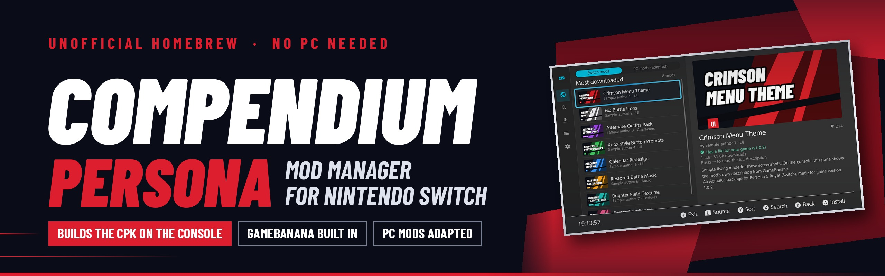
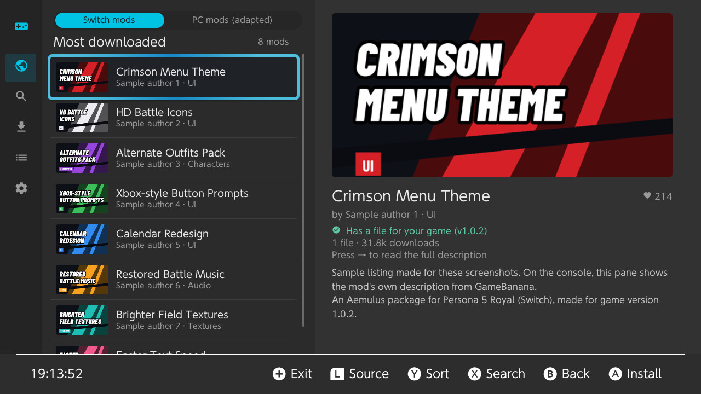
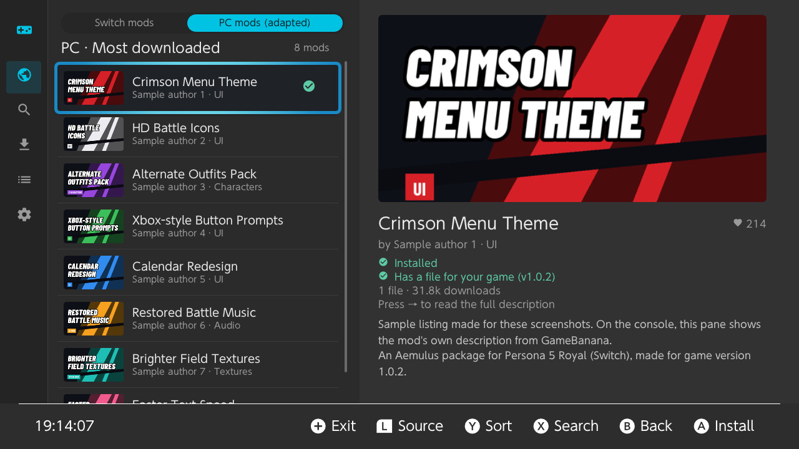
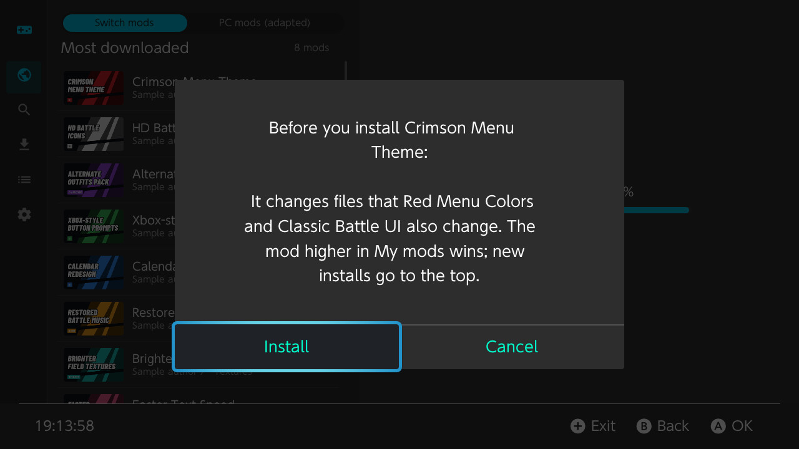
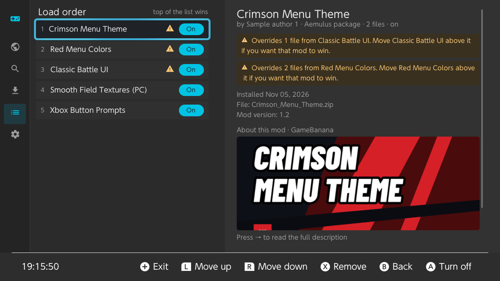
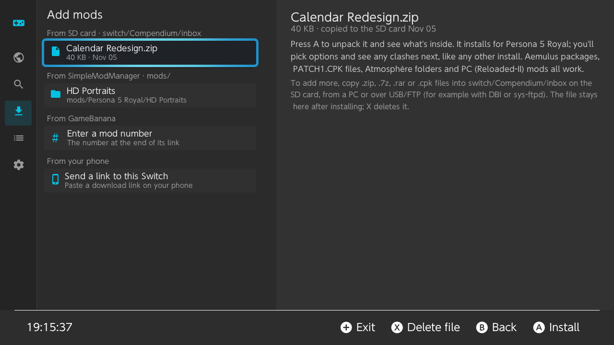
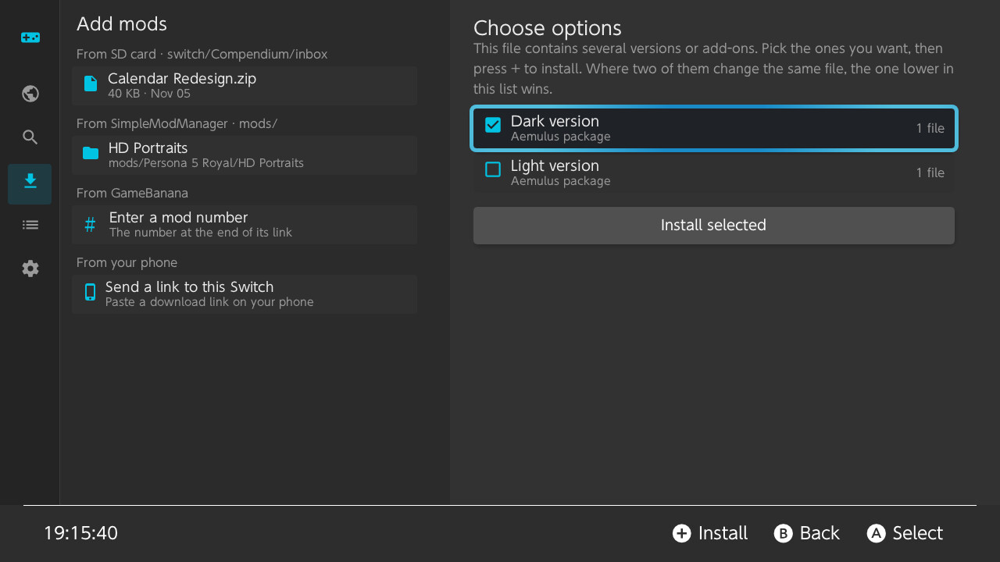
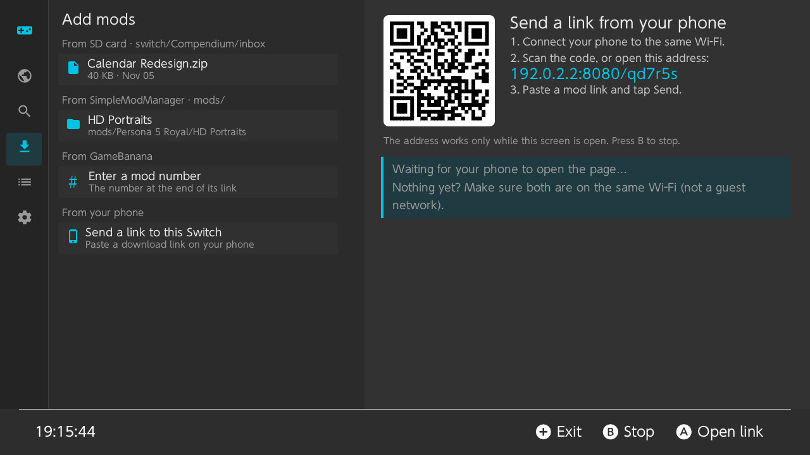
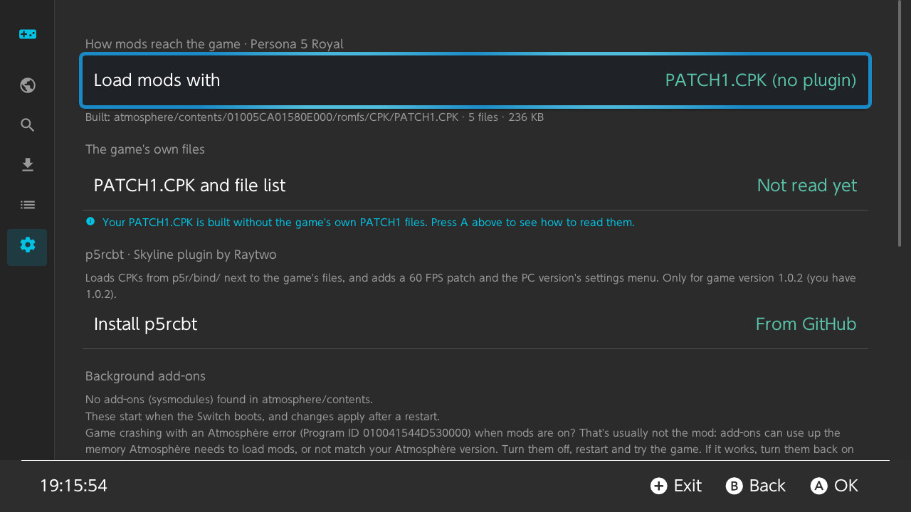
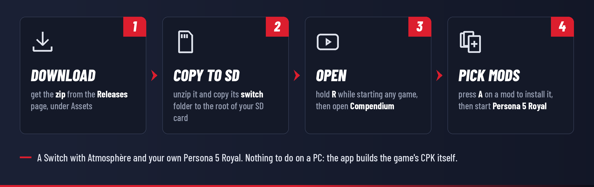

<div align="center">

[](README.md)
[](README.es.md)



# Compendium: Persona mod manager for Nintendo Switch

**An unofficial homebrew app that installs and manages mods for the Persona games, right on the Switch.**<br>
Browse GameBanana, pick a mod, and Compendium builds the `.CPK` archive Persona 5 Royal reads, on the console
itself. No PC, no CriPakTools, no copying folders by hand.

[](../../releases)
[](../../releases)


[](LICENSE)
[](https://ko-fi.com/S4I32A0WMU)

[Install](#how-to-install) · [Using it](#using-it) · [Which mods work](#which-mods-work) · [Status](#status) · [FAQ](#faq) · [Troubleshooting](docs/INSTALL.md#troubleshooting) · [Changelog](CHANGELOG.md) · [How it works](docs/TECHNICAL.md)

[](https://ko-fi.com/S4I32A0WMU)

</div>

> [!IMPORTANT]
> **No game files are included, not in this repository and not in the releases.** You need your own copy of
> *Persona 5 Royal* for Nintendo Switch. Mods belong to their authors: Compendium downloads them from where
> they're published (GameBanana, GitHub) and doesn't host any. Please don't ask for game files in issues.
>
> Compendium runs on the **Switch** and installs mods into the **Switch version** of the game. It can adapt
> many mods made for the PC version ([which ones](#which-mods-work)), but it doesn't mod the PC game.

> [!NOTE]
> **Tested on a Switch.** Compendium browses GameBanana and installs mods on a Switch Lite. Testing there found two
> bugs, now fixed: installs failed in 0.0.1, and mods packed to be built with CriWare's tool on a PC, like the one
> that brings back Persona 5's opening, didn't show in 0.0.2. It's still a test version: back up your saves, use
> emuMMC, and [tell us](#help-wanted-testers) how your mods work in the game.

> [!TIP]
> **New in 0.0.4: more mods end up where the game looks for them.** Every Persona 5 Royal mod for Switch on
> GameBanana went through the app's rules, and the ones that would go to the wrong place are fixed: folders named
> after the PC version's CPKs (`BASE.CPK`), English voices in `SOUND_E`, and the game's `BUSTUP` and `CUTIN` folders.
> Exefs patches (`.ips`) install in Atmosphère's folder, files that come without any folder go where the game has
> one with the same name, and save files and emulator-only mods get a clear message instead of being installed.
>
> **0.0.3: mods made to be packed on a PC work**, like the one that brings back Persona 5's opening (a `PATCH1`
> folder with CriWare's `cpkmakec`), and the game's own copy of a file no longer hides the mod's.
>
> **0.0.2: mods install on the Switch.** The error that stopped every install in 0.0.1 is fixed, and mods
> 0.0.1 already downloaded install without downloading again. The release is now a zip with the `switch` folder
> ready to copy onto the SD card, with a short guide in English and Spanish. And a new icon.
>
> **0.0.1, the first version:** GameBanana's Persona 5 Royal mods (Switch and PC) on the console, the game's
> `PATCH1.CPK` built on the Switch, Aemulus packages and other mod formats, load order and conflicts, p5rcbt.
>
> All the details are in the [changelog](CHANGELOG.md).

## Screenshots

<p align="center"><sub>Shown with sample listings in place of GameBanana's: on the console, every mod shows its own
pictures and description.</sub></p>

<table>
  <tr>
    <td width="50%"></td>
    <td width="50%"></td>
  </tr>
  <tr>
    <td align="center"><sub>Browse GameBanana's Persona 5 Royal mods, with pictures and details</sub></td>
    <td align="center"><sub>Mods made for the PC version, adapted for the Switch when you install them</sub></td>
  </tr>
  <tr>
    <td></td>
    <td></td>
  </tr>
  <tr>
    <td align="center"><sub>Before installing, it tells you which of your mods change the same files</sub></td>
    <td align="center"><sub>My mods: load order, conflicts, and on/off without deleting anything</sub></td>
  </tr>
  <tr>
    <td></td>
    <td></td>
  </tr>
  <tr>
    <td align="center"><sub>Add mods from the SD card, SimpleModManager, a mod number or your phone</sub></td>
    <td align="center"><sub>Mods that come in several versions: pick the ones you want</sub></td>
  </tr>
  <tr>
    <td></td>
    <td></td>
  </tr>
  <tr>
    <td align="center"><sub>Found a mod on your phone? Scan the code and send the link to the Switch</sub></td>
    <td align="center"><sub>Settings: how mods reach the game, p5rcbt, background add-ons</sub></td>
  </tr>
</table>

## Features

- **Builds the CPK on the console.** Persona 5 Royal reads its files from `.CPK` archives, so its mods have to
  be packed into one. Compendium does that on the Switch: your mods go into the game's `PATCH1.CPK`, together
  with the game's own PATCH1 files, every time you add, remove or turn one off.
- **GameBanana built in.** Browse and search Persona 5 Royal's mods with their pictures, descriptions and
  files, and install one with **A**. The file that fits your game version is highlighted.
- **PC mods adapted.** Mods made for the PC version with Reloaded-II (P5R Essentials) are turned into Switch
  mods when you install them: their game files go into the CPK.
- **Many mod formats:** Aemulus packages (the usual format for Switch mods), ready-made `PATCH1.CPK` files,
  Atmosphère and SimpleModManager folders, p5rcbt folders and loose game files ([details](#which-mods-work)).
- **Several mods at once, with a load order.** When two mods change the same file, the one higher in My mods
  wins, and the app tells you which files clash before you install.
- **On and off without deleting.** A copy of every mod is kept, so turning one off just builds the CPK again
  without it. Hold **L** while starting the game to play once without any mods.
- **Mods from anywhere:** GameBanana, a mod's number, GitHub projects (their latest release), a link sent
  from your phone with a QR code, or archives you copy to `switch/Compendium/inbox`.
- **Brings in what you already have:** mods kept for **SimpleModManager** (`sd:/mods/…`) and a `PATCH1.CPK`
  you copied by hand.
- **p5rcbt support.** Install the p5rcbt Skyline plugin from Settings and change its options (60 FPS, the PC
  version's settings menu).
- **Careful with your SD card.** Files already where the app writes are set aside and put back when your mods
  are off, and the app explains Atmosphère's mod-loading crash (Program ID 010041544D530000) if it happens.
- **A log for bug reports** (`switch/Compendium/log.txt`): what was installed and built, and any errors.

## What you need

| | What |
|---|---|
| **Console** | A Nintendo Switch, Switch OLED or Switch Lite running [Atmosphère](https://github.com/Atmosphere-NX/Atmosphere) with the Homebrew Menu. Use emuMMC and keep a backup of your SD card and saves. |
| **Game** | Your own *Persona 5 Royal* for Switch (title ID `01005CA01580E000`). Any version works with the default mode; the p5rcbt plugin needs version **1.0.2**. |
| **Internet** | Wi-Fi, to browse and download mods. Without it, copy mod archives to `switch/Compendium/inbox`. |
| **SD card** | Room for your mods twice: the app keeps a copy of each, and builds the CPK from them. |
| **PC** | Not needed. |

## How to install

> [!TIP]
> **New to Switch homebrew?** First set up your console with custom firmware (Atmosphère) and the Homebrew
> Menu: the community guide [switch.hacks.guide](https://switch.hacks.guide/) explains it step by step.
> Unsure what emuMMC, LayeredFS or a CPK are? See the [glossary](docs/INSTALL.md#glossary).



1. **Download.** On the [Releases](../../releases) page, under **Assets**, download **`Compendium-<version>.zip`**
   (not "Source code", which is only for developers).
2. **Copy to the SD card.** Unzip it and copy its **`switch`** folder to the root of your SD card. It joins the
   `switch` folder already there, and the app ends up in `switch/Compendium/`. On a Mac, copy just the
   `Compendium` folder into your SD card's `switch` folder instead (Finder replaces folders rather than joining
   them).
3. **Open.** Hold **R** while you start any game to open the Homebrew Menu, then choose **Compendium**.
4. **Pick mods.** On **Browse**, press **A** on a mod, then **A** on its file. Press **+** to close the app and
   start Persona 5 Royal: your mods are in.

> [!WARNING]
> Open the Homebrew Menu with **R + a game** (title takeover) when you can. From the Album, homebrew gets much
> less memory: Compendium works there, but large mods can run out of it.

### One-time step: the game's own files (recommended)

`PATCH1.CPK` comes with the game's update and holds a few of its files. So the app can keep them when it builds
the one for your mods, let it read them once (and again after a game update):

1. Press **+** to close the app.
2. Hold **L and R** and start Persona 5 Royal. Keep holding until the Homebrew Menu opens.
   (R opens the Homebrew Menu in place of the game; L turns mods off for that launch.)
3. Open Compendium. It reads the files by itself and tells you when it's done.

It also reads the game's file list, which it uses to place the files of mods that leave out their CPK folder.

<details>
<summary><b>What the SD card looks like</b></summary>

```
sd:/
├── switch/Compendium/
│   ├── Compendium.nro       the app
│   ├── README.txt           a short guide, in English and Spanish
│   ├── LICENSES.txt         Compendium's license and the open-source components it uses
│   ├── library/             a copy of every installed mod
│   ├── inbox/               put archives here to install them from Add mods
│   ├── original/            the game's own PATCH1.CPK and file list (the one-time step)
│   ├── backup/              your own files the app set aside (put back when mods are off)
│   ├── settings.json        the app's settings
│   ├── state.json           what's installed and built
│   └── log.txt              what the app did and any errors: attach it to bug reports
├── atmosphere/contents/01005CA01580E000/
│   └── romfs/CPK/PATCH1.CPK the CPK built from your mods (default mode)
└── p5r/bind/Compendium.cpk  the CPK built from your mods (p5rcbt mode)
```

</details>

The [full install guide](docs/INSTALL.md) covers updating, backups, getting mods without Wi-Fi and
[troubleshooting](docs/INSTALL.md#troubleshooting).

### Updating

Copy the new zip's `switch` folder over the old one (or just replace `Compendium.nro`). Your mods, load order and
settings are kept.

## Using it

| Page | What it does | Buttons |
|---|---|---|
| **Browse** | GameBanana's Persona 5 Royal mods | **L / R** Switch mods or PC mods · **Y** sort · **X** search · **A** install |
| **Search** | Search by name or author, or type a mod's number (the end of its GameBanana link) | **X** search · **A** open |
| **Add mods** | Archives in `switch/Compendium/inbox`, SimpleModManager's mods, a `PATCH1.CPK` copied by hand, a link from your phone, a mod number | **A** install · **X** delete the file |
| **My mods** | Your load order: the mod at the top wins | **A** on/off · **L / R** move up/down · **X** remove |
| **Settings** | How mods reach the game, the game's own files, p5rcbt, background add-ons, storage | **A** change |

**+** closes the app from any page, and **B** goes back.

## Which mods work

| What the mod comes as | What the app does |
|---|---|
| **Aemulus package** (a folder with `Package.xml`), the usual format for P5R Switch mods | Its files go into the CPK at the paths they have, as Aemulus does |
| **A ready-made `PATCH1.CPK`** or any mod `.cpk` | Its files are used as they are, merged with your other mods |
| **Atmosphère or SimpleModManager folders** (`atmosphere/contents/01005CA01580E000/…`) | The CPK inside is merged; cheats, exefs patches and plugins go to the SD card |
| **Loose game files** (`BASE/…`, `EN/…`, `PATCH1/…`, Aemulus' `romfs/CPK/PATCH1/…`, CriPakTools' `PATCH1.CPK_unpacked`) | Packed into the CPK |
| **p5rcbt folders** (`p5r/bind/…`) | Packed into the CPK |
| **PC mods for Reloaded-II** (`ModConfig.json`, `P5REssentials/CPK/…`) | Adapted: their game files are packed into the CPK. Most PC mods' files work on Switch too, but not all |

Not supported yet (the app says so when you install): the parts Aemulus merges on a PC (`.flow`, `.msg`,
`.tblpatch`, sprite and binary patches), Reloaded-II's FEmulator merging, and PC code mods (`.dll`), which
can't run on the Switch. The rest of such a mod is still installed.

### How mods reach the game

Choose in **Settings → Load mods with**:

- **PATCH1.CPK (no plugin)**, the default. The app builds `atmosphere/contents/01005CA01580E000/romfs/CPK/PATCH1.CPK`
  with your mods and the game's own PATCH1 files, and Atmosphère's LayeredFS loads it. Works with any game version.
- **p5rcbt (Skyline plugin).** The app builds `p5r/bind/Compendium.cpk`, which [p5rcbt](https://github.com/Raytwo/p5rcbt)
  adds to the game's files. The game's PATCH1.CPK stays untouched. p5rcbt only works with game version **1.0.2**;
  install it from Settings.

## Status

> [!NOTE]
> **Testing.** The app browses GameBanana and installs mods on a Switch; the next reports will say how mods work in
> the game. The app's core (the CPK builder, the mod formats, the
> load order) is checked by automated tests on every change. Back up your saves and use emuMMC.

| Part | State |
|---|---|
| Opening the app, browsing and searching GameBanana | ✅ Works on a Switch |
| Downloading and installing mods | ✅ Works on a Switch since 0.0.2 |
| Building PATCH1.CPK (default mode) | 🧪 Checked by tests; waiting for reports of mods showing in the game |
| Aemulus packages, CPKs, Atmosphère / SimpleModManager / p5rcbt folders, loose files | 🧪 Checked by tests; waiting for reports |
| PC mods (Reloaded-II) | 🧪 Game files adapted; ❌ `.dll` code mods can't run on the Switch |
| p5rcbt mode and its settings | 🧪 Game version 1.0.2 only |
| Aemulus merging (table patches `.tbp`/`.tblpatch`, files that go inside the game's `.PAK`/`.BIN` archives, `.flow`, `.msg`, sprites, binary patches) | ❌ Not yet: the rest of those mods installs |
| A new interface | 🔜 Planned: the app's look will change in later versions |
| Persona 4 Golden, Persona 3 Portable, Persona 5 Strikers, Persona 5 Tactica, Persona 4 Arena Ultimax | 🔜 Planned for later versions |

**Known issues**
- 0.0.1 can't install mods on a Switch, 0.0.2 doesn't apply mods made to be packed with `cpkmakec` (like
  Persona 5's opening), and 0.0.3 puts some packages' files in the wrong folder: use 0.0.4.
- Changes that Aemulus merges on a PC don't show yet. In about ten of GameBanana's mods (new names, stats or item
  descriptions), the models and textures install, but those changes don't.

See the [changelog](CHANGELOG.md) for what changed in each version.

## Help wanted: testers

Reports from real consoles help the most right now, in English or Spanish, with `log.txt` from
`switch/Compendium/`:

| What | How to help |
|---|---|
| 🎮 **Does a mod show up in the game?** | Install one small mod (a UI or texture mod is easiest to see), start Persona 5 Royal and check. Did it show? |
| 📦 **The game's own files** | Do the [one-time step](#one-time-step-the-games-own-files-recommended) (L + R while starting the game). Did the app say it read PATCH1.CPK? |
| 🖥️ **PC mods** | Install a mod from the **PC mods** tab. Does it work in the game? Which one was it? |
| 🧩 **Mod formats** | A mod the app couldn't read, or that installed but didn't work: send the link to its page. |
| 🔌 **p5rcbt** (game version 1.0.2) | Install p5rcbt from Settings and switch **Load mods with** to p5rcbt. Do your mods and the 60 FPS option work? |
| 📱 **Phone link** | Send a mod link from your phone with the QR code. Did it arrive? |

Open an [issue](../../issues/new/choose): the form asks for everything needed.

## FAQ

<details>
<summary><b>Do I need a PC?</b></summary>

No. Compendium finds, downloads, unpacks and installs mods on the Switch, and builds the game's CPK there too.
A PC (or a phone) is only handy for finding mods on a bigger screen: send the link to the Switch with the QR
code on the **Add mods** page.
</details>

<details>
<summary><b>Why does it have to build a CPK? Can't I just copy the mod's folder?</b></summary>

Persona 5 Royal keeps its files inside big `.CPK` archives. Atmosphère's LayeredFS can replace whole files in
a game, but not single files inside an archive, so Switch mods for P5R come as a `PATCH1.CPK` with their files
in it. There's only one `PATCH1.CPK`, though, so two mods that each bring their own would overwrite each other.

Compendium solves both: it takes the files from every mod that's on, in your load order, adds the game's own
PATCH1 files, and writes one `PATCH1.CPK` with all of them. On a PC, that's what Aemulus or CriPakTools do.
</details>

<details>
<summary><b>Can I use several mods at the same time?</b></summary>

Yes. Every mod that's on goes into the same CPK. If two of them change the same file, only one can win: the one
higher in **My mods**. The app warns you before installing, and My mods marks the mods that clash. Move a mod
up with **L** to let it win.
</details>

<details>
<summary><b>Is this Aemulus or Reloaded-II for Switch?</b></summary>

Not exactly. It does on the Switch what Aemulus does for P5R Switch mods on a PC: puts the mods' files into a
CPK, in a load order. Aemulus' merging of game scripts and text (`.flow`, `.msg`, `.tblpatch`) isn't there yet.
Reloaded-II mods for the PC version are adapted: their game files are used; code mods (`.dll`) can't run on
the Switch.
</details>

<details>
<summary><b>I already have mods installed by hand or with SimpleModManager. What happens to them?</b></summary>

Nothing is lost. On **Add mods**, the app lists SimpleModManager's mods (`sd:/mods/…`) and a `PATCH1.CPK` you
copied by hand, and can add them to the list, so they're merged with your other mods. Files already where the
app writes are moved to `switch/Compendium/backup/` and put back when your mods are off.
</details>

<details>
<summary><b>Which game version do I need?</b></summary>

Any, with the default mode (PATCH1.CPK). The p5rcbt plugin only works with version 1.0.2. Some mods are made
for a specific version: on the Browse page, the file that fits yours is marked **Matches your game**.
</details>

<details>
<summary><b>A mod doesn't show up, or the game crashes. What now?</b></summary>

See [troubleshooting](docs/INSTALL.md#troubleshooting). In short: check that the mod is on and above mods that
change the same files, turn off the mods you added last one at a time, and hold **L** while starting the game to
check it works without mods. If the game shows an Atmosphère error with Program ID `010041544D530000`, turn off
background add-ons in Settings. Then please [open an issue](../../issues/new/choose) with `log.txt`.
</details>

<details>
<summary><b>What about the other Persona games?</b></summary>

They're planned. The app is built around a list of games, and Persona 5 Royal is the first; Persona 4 Golden,
Persona 3 Portable and the others on Switch come later, each one once its mod format is supported and tested.
</details>

<details>
<summary><b>Can it get my console banned?</b></summary>

Mods change the game's files only on your SD card, but going online with custom firmware can get a console
banned from Nintendo's services. Mod on an emuMMC and keep Nintendo's servers blocked (for example with
Atmosphère's DNS redirection or 90DNS). That decision is yours.
</details>

<details>
<summary><b>Why "Compendium"?</b></summary>

In the Persona games, the Compendium is where your Personas are kept, ready to be summoned again. Here it keeps
your mods: every one you install stays in the library, ready to turn back on.
</details>

## How it works

1. **Finds and downloads mods** through GameBanana's API, GitHub's releases, or a link from your phone.
2. **Looks inside each archive** and recognizes what the mod is (an Aemulus package, a CPK, an Atmosphère
   folder, a PC mod…), and which of its versions fit your game.
3. **Keeps a copy** of the mod in its library, with the CPK paths of its files.
4. **Builds one CPK** with the files of every mod that's on (the one higher in the list wins) and the game's own
   PATCH1 files, with a CPK reader and writer written for the app from CRI's format (file names, 2 KB alignment,
   CRILAYLA decompression).
5. **Atmosphère's LayeredFS** gives the game that CPK in place of its own `PATCH1.CPK` (or p5rcbt loads it).

More in [docs/TECHNICAL.md](docs/TECHNICAL.md): the CPK format, how mod formats are recognized, the library and
the source layout.

## Building from source

You need [devkitPro](https://devkitpro.org/wiki/Getting_Started) with `switch-dev` and `switch-portlibs`, and
CMake. Then:

```sh
git clone --recursive https://github.com/SantiBros/Compendium-NX
cd Compendium-NX
cmake -S . -B build-switch -DPLATFORM_SWITCH=ON -DCMAKE_BUILD_TYPE=Release
cmake --build build-switch --target Compendium.nro
```

The result is `build-switch/Compendium.nro`. [docs/BUILDING.md](docs/BUILDING.md) has the details, the tests,
the PC test build and how a release is made.

## Support

If you enjoy this project, you can support my work on Ko-fi. It helps me keep updating my projects and make new ones!

[](https://ko-fi.com/S4I32A0WMU)

## Credits

Standing on the shoulders of others:

- **ATLUS** and **SEGA**, who made the Persona games. Please support the originals.
- **The modders** who share their work on GameBanana and elsewhere: Compendium only installs what they make.
- [**Patchwork**](https://github.com/TheRomeoAlfa/patchwork-nx) by TheRomeoAlfa: Compendium is based on it
  (GameBanana client, downloads, archives, interface).
- [**SimpleModManager**](https://github.com/nadrino/SimpleModManager) by nadrino: its mod folders can be brought
  in, and its way of managing LayeredFS mods.
- [**p5rcbt**](https://github.com/Raytwo/p5rcbt) by Raytwo: the optional plugin.
- [**ShrineFox**](https://docs.shrinefox.com), [**Aemulus**](https://github.com/TekkaGB/AemulusModManager) by
  TekkaGB and [**PyCriCodecs**](https://github.com/Youjose/PyCriCodecs): documentation of P5R's mod formats and
  CRI's CPK format.
- [**Borealis**](https://github.com/xfangfang/borealis) (xfangfang's fork), [**libnx**](https://github.com/switchbrew/libnx),
  [**devkitPro**](https://devkitpro.org) and [**Atmosphère**](https://github.com/Atmosphere-NX/Atmosphere).
- **libcurl**, **libarchive**, **mbedTLS**, **zlib**, **nlohmann/json** and the other libraries in
  [THIRD_PARTY.md](THIRD_PARTY.md).
- **Barlow Condensed** by Jeremy Tribby (SIL Open Font License), used in the banner and the icon.

## License

Compendium is free software under the [GNU General Public License v3.0](LICENSE), like Patchwork and
SimpleModManager it builds on. The third-party code keeps its own licenses ([THIRD_PARTY.md](THIRD_PARTY.md)).
The games and the mods are not included and are not covered by this license in any way.

## Disclaimer

This is an unofficial fan project. It is not affiliated with, endorsed or sponsored by ATLUS, SEGA, Nintendo
or GameBanana. *Persona* is a trademark of ATLUS; Nintendo Switch is a trademark of Nintendo. No game code or
data is distributed here: you need your own copy of the game. Mods are their authors' work, downloaded from
where they publish them; follow their terms.

Running homebrew requires custom firmware, which is against Nintendo's terms of service and can get a console
banned from online services; that decision is yours. The software is provided as is, without warranty (see
[LICENSE](LICENSE)).

---

<div align="center">

A project by **SantiBros** · If you enjoy it, star the repo ⭐ and share it

</div>
