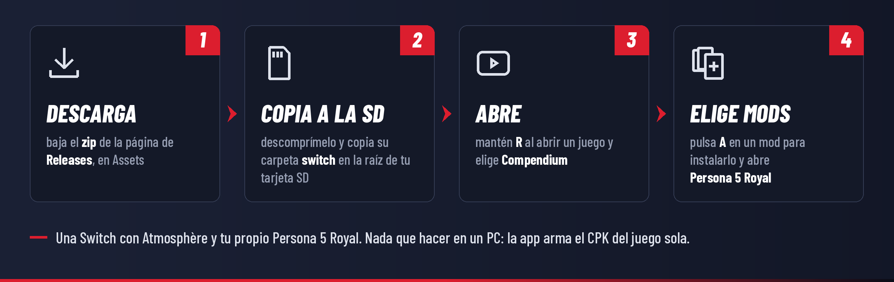

# Instalar y usar Compendium

[](INSTALL.md)
[](INSTALL.es.md)

[← Volver al README](../README.es.md)

> [!TIP]
> **¿Nuevo en el homebrew de Switch?** Primero necesitas una consola con firmware personalizado (Atmosphère) y el
> Homebrew Menu. La guía de la comunidad [switch.hacks.guide](https://switch.hacks.guide/) explica cómo, paso a
> paso. Las palabras que se usan en esta página se explican en el [glosario](#glosario).

La app está en inglés por ahora: los nombres de botones y páginas aparecen aquí tal como se ven en la consola.

## Qué necesitas

- Una Nintendo Switch, Switch OLED o Switch Lite con [Atmosphère](https://github.com/Atmosphere-NX/Atmosphere) y
  el Homebrew Menu. Un **emuMMC** es la forma más segura de usar mods.
- Tu propio **Persona 5 Royal** para Switch (ID de título `01005CA01580E000`). Cualquier versión funciona con el
  modo predeterminado; el plugin opcional p5rcbt necesita la versión 1.0.2.
- Wi-Fi para explorar y descargar mods (o una forma de copiar los archivos de los mods a la tarjeta SD).
- Espacio libre en la tarjeta SD para tus mods dos veces: la app guarda una copia de cada uno y arma el CPK del
  juego a partir de ellas.

Antes de empezar, haz copia de tus partidas (por ejemplo con [JKSV](https://github.com/J-D-K/JKSV)) y guarda una
copia de tu tarjeta SD. Un mod dañado o incompatible puede hacer que el juego se cierre; no puede dañar la
consola, y desactivar los mods siempre deja el juego como estaba.

## Instalar



1. En la página de [Releases](../../../releases), en **Assets**, descarga **`Compendium-<versión>.zip`**.
   ("Source code" es solo para desarrolladores.)
2. Descomprímelo. Dentro hay una carpeta `switch` con todo en su lugar: `switch/Compendium/Compendium.nro`, una
   guía corta (`README.txt`), las licencias y la carpeta `inbox` vacía.
3. Copia esa carpeta **`switch`** en la raíz de tu tarjeta SD. Se une a la carpeta `switch` que ya está, junto a
   tu otro homebrew.
   - **En un Mac**, Finder reemplaza la carpeta en vez de unirla, lo que borraría tu otro homebrew. Ahí, abre la
     carpeta `switch` del zip y copia solo la carpeta **`Compendium`** dentro de la carpeta `switch` de tu SD.
   - Copiar por USB con DBI (MTP) o por FTP funciona igual.
4. Vuelve a poner la tarjeta SD y enciende la consola.

## Abrir la app

Mantén **R** mientras abres cualquier juego: aparece el Homebrew Menu en lugar del juego. Elige **Compendium**.

> [!WARNING]
> Abierto desde el **Álbum**, el homebrew recibe mucha menos memoria. Compendium funciona ahí, pero descargar o
> armar mods grandes puede quedarse sin memoria; la app lo avisa si pasa. Usa **R + un juego** siempre que puedas.

En el primer inicio, la app crea su carpeta (`switch/Compendium/`), revisa tu versión del juego y muestra la
página **Browse**. No cambia nada en la tarjeta SD hasta que instalas un mod.

## Los archivos del propio juego (paso único, recomendado)

La actualización de Persona 5 Royal trae un `PATCH1.CPK` con algunos archivos del propio juego. En el modo
predeterminado, Compendium arma un `PATCH1.CPK` nuevo con tus mods; para que también conserve los archivos del
juego, la app tiene que leerlos una vez:

1. Pulsa **+** para cerrar Compendium.
2. Mantén **L y R** y abre Persona 5 Royal. Sigue manteniendo hasta que aparezca el Homebrew Menu.
   (R abre el Homebrew Menu en lugar del juego; L desactiva los mods en ese inicio, para que la app vea los
   archivos originales del juego y no una copia con mods.)
3. Abre Compendium. Copia el `PATCH1.CPK` del juego y su lista de archivos en `switch/Compendium/original/` y te
   avisa cuando termina.

Repítelo después de cada actualización del juego. Mientras no lo hagas, Settings muestra **Not read yet**, y el
CPK se arma solo con tus mods, lo que funciona para la mayoría de los mods.

La lista de archivos también ayuda con los mods que no traen su carpeta del CPK (un `BTL_UI.PAK` suelto en vez de
`BASE/BATTLE/GUI/BTL_UI.PAK`): la app busca dónde guarda el juego ese archivo.

## Instalar mods

**Desde GameBanana.** En **Browse**, **L / R** cambian entre mods de Switch y mods de PC, **Y** cambia el orden
(más descargados, más gustados, más nuevos, actualizados hace poco) y **X** busca. Pulsa **A** en un mod y luego
**A** en su archivo: el que corresponde a tu versión del juego aparece marcado con **Matches your game**.
**Search** busca mods por nombre o autor, o por su número (el final del enlace del mod en GameBanana:
`gamebanana.com/mods/123456`).

**Desde tu móvil o computador.** En **Add mods → Send a link to this Switch**, escanea el código QR con un móvil
conectado al mismo Wi-Fi (o escribe la dirección que aparece en un navegador) y pega el enlace de un mod: una
página de GameBanana, un proyecto de GitHub (se usa su última versión publicada) o un enlace de descarga directa.

**Desde la tarjeta SD.** Copia archivos `.zip`, `.7z`, `.rar` o `.cpk` en `switch/Compendium/inbox/` (con un PC, o
por USB o Wi-Fi con DBI o sys-ftpd) e instálalos desde **Add mods**. El archivo se queda en la carpeta después de
instalarlo; **X** lo borra.

**Los mods que ya tienes.** **Add mods** también muestra los mods guardados para SimpleModManager
(`sd:/mods/Persona 5 Royal/…`) y un `PATCH1.CPK` que hayas copiado a mano en
`atmosphere/contents/01005CA01580E000/romfs/CPK/`. Al agregarlos quedan en tu lista, así que se combinan con tus
otros mods en lugar de ser reemplazados.

**Mods con opciones.** Si un archivo trae varias versiones o complementos (carpetas con su propio `Package.xml`,
por ejemplo), la app te deja elegir: **A** marca una, **+** instala las que marcaste.

Antes de instalar, la app te avisa si el mod cambia archivos que también cambia alguno de tus mods, y qué partes
no pudo usar (por ejemplo, scripts `.flow` que necesitan Aemulus en un PC). Cada mod nuevo va arriba de la lista,
activado.

## Orden de carga y desactivar mods

**My mods** es tu orden de carga. Cuando dos mods cambian el mismo archivo, gana el que está más arriba; los mods
que chocan se marcan con ⚠, y el panel de la derecha dice qué archivos y qué hacer. **L** y **R** suben y bajan el
mod elegido, **A** lo activa o desactiva, **X** lo quita (se borra su copia en la biblioteca).

Cada cambio vuelve a armar el CPK del juego, así que siempre coincide con la lista. Para jugar una vez sin ningún
mod, mantén **L** al abrir el juego (es el interruptor propio de Atmosphère, así que funciona incluso sin la app).

## Ajustes

- **Load mods with:** PATCH1.CPK (el predeterminado, sin plugin) o p5rcbt (el plugin de Skyline, versión 1.0.2
  del juego). Al cambiar, tus mods pasan de uno a otro.
- **Los archivos del propio juego:** si se leyeron, y cómo.
- **p5rcbt:** instálalo desde GitHub y cambia sus opciones (60 FPS, el menú de ajustes de la versión de PC, el
  registro).
- **Background add-ons** (complementos en segundo plano): los sysmodules de `atmosphere/contents`, cuáles se
  conocen, y desactivarlos. Arrancan al encender la consola, así que los cambios se aplican después de reiniciar.
- **Storage** (almacenamiento) y **Build the game's mod files again** (una reparación, si la tarjeta SD se cambió
  a mano).

## La carpeta de la app

```
sd:/switch/Compendium/
├── Compendium.nro     la app
├── README.txt         una guía corta (del zip)
├── LICENSES.txt       la licencia de Compendium y los avisos de terceros (del zip)
├── library/p5r/<mod>/ una copia de cada mod instalado: files/, cpk/ y sd/
├── inbox/             archivos para instalar desde Add mods
├── original/p5r/      el PATCH1.CPK y la lista de archivos del juego
├── backup/            archivos que estaban en la SD donde escribe la app (vuelven después)
├── settings.json      los ajustes de la app
├── state.json         qué está instalado, el orden de carga y qué se armó
└── log.txt            qué hizo la app y cualquier error (log.old.txt es el anterior)
```

Y los archivos que arma:

| Modo | Archivo |
|---|---|
| PATCH1.CPK (predeterminado) | `atmosphere/contents/01005CA01580E000/romfs/CPK/PATCH1.CPK` |
| p5rcbt | `p5r/bind/Compendium.cpk` (y el propio p5rcbt en `atmosphere/contents/01005CA01580E000/exefs/` y `romfs/skyline/plugins/`) |

Los mods con trucos, parches de exefs o plugins de Skyline también los ponen en
`atmosphere/contents/01005CA01580E000/`.

## Actualizar

Copia la carpeta `switch` del zip nuevo sobre la anterior, como al instalar (o reemplaza solo `Compendium.nro`).
Tu biblioteca, el orden de carga y los ajustes se conservan. Después de
una actualización del **juego**, repite el [paso único](#los-archivos-del-propio-juego-paso-único-recomendado).

## Quitar Compendium

Desactiva (o quita) todos los mods en **My mods**: la app borra el CPK que armó y devuelve los archivos que había
guardado aparte. Luego borra `switch/Compendium/`.

## Solución de problemas

| Mensaje o problema | Qué hacer |
|---|---|
| **"Install failed: filesystem error: cannot make canonical path"** | Un error de la 0.0.1 en la Switch: actualiza a la 0.0.2 o una más nueva. Los mods que ya descargó se instalan sin volver a descargarse. |
| **Un mod no aparece en el juego** | Comprueba que esté activado en **My mods** y por encima de cualquier mod marcado con ⚠ que cambie los mismos archivos. Asegúrate de no mantener **L** al abrir el juego. Luego **Settings → Build the game's mod files again**. |
| **El juego se cierra o se congela al abrir después de instalar un mod** | Desactiva uno a uno los últimos mods que agregaste para encontrarlo. Revisa su página: algunos mods son para otra versión del juego, o solo para la versión de PC. Mantén **L** al abrir el juego para comprobar que funciona sin mods. |
| **Error de Atmosphère con Program ID 010041544D530000** | Atmosphère se quedó sin memoria al cargar los mods. Normalmente son los complementos en segundo plano (sysmodules), no el mod: desactívalos en **Settings → Background add-ons**, reinicia la consola y vuelve a intentarlo. La app lo avisa cuando encuentra el reporte del cierre. |
| **"Couldn't reach GameBanana" / errores de conexión segura** | Revisa la fecha y la hora de la consola (una fecha mal puesta rompe las conexiones seguras), y luego el Wi-Fi. Un bloqueador de DNS que también bloquee GameBanana da el mismo error. |
| **"Compendium ran out of memory"** | Se abrió desde el Álbum. Ciérrala con **+**, mantén **R** al abrir un juego y ábrela desde el Homebrew Menu que aparece. |
| **"There isn't enough space on the SD card"** | La app lo revisa antes de escribir nada. Libera espacio, o quita los mods que no uses. |
| **"Can't install this file"** | La app no encontró archivos del juego dentro (un mod de otro juego, o una herramienta en vez de un mod). El mensaje dice qué encontró. Si crees que es un mod de P5R, por favor [repórtalo](#reportar-un-error) con el enlace. |
| **"This is a save file, not a mod"** | Las partidas guardadas (`DATA01/DATA.DAT`…) van en los datos de guardado del juego, no en sus archivos: cópialas con un gestor de partidas como [JKSV](https://github.com/J-D-K/JKSV), después de hacer copia de tu propia partida. |
| **El modo p5rcbt no hace nada** | p5rcbt necesita la versión 1.0.2 del juego; comprueba que esté instalado (Settings) y activado en My mods. |
| **El móvil no abre la dirección** | El móvil y la Switch deben estar en el mismo Wi-Fi, no en una red de invitados que aísla los dispositivos. La dirección solo funciona mientras esa pantalla está abierta. |
| **Los archivos del propio juego dicen "Not read yet"** | Haz el [paso único](#los-archivos-del-propio-juego-paso-único-recomendado): mantén **L y R** al abrir el juego, sigue manteniendo hasta que aparezca el Homebrew Menu y abre Compendium. |

## Reportar un error

Usa el [formulario de errores](../../../issues/new/choose) (en español o en inglés) y adjunta
`switch/Compendium/log.txt` (y `log.old.txt` si el problema fue en una sesión anterior). Si el juego o la app se
cerraron con un error de Atmosphère, el archivo más reciente de `atmosphere/crash_reports/` también ayuda. Incluye
los enlaces de los mods que usabas. Por favor, nunca adjuntes archivos del juego.

## Glosario

| Palabra | Qué significa |
|---|---|
| **Atmosphère** | El firmware personalizado que permite a la Switch ejecutar homebrew y cargar mods. |
| **emuMMC** | Una copia del sistema de la Switch en la tarjeta SD, para usar firmware personalizado sin tocar el sistema propio de la consola. La forma más segura de usar homebrew y mods. |
| **Homebrew Menu** | El menú que muestra y abre las apps homebrew (archivos `.nro`). |
| **Title takeover** | Abrir el Homebrew Menu manteniendo **R** al iniciar un juego, para que el homebrew reciba toda la memoria que recibe un juego. |
| **LayeredFS** | La forma en que Atmosphère carga mods: los archivos de `atmosphere/contents/<ID de título>/romfs/` se usan en lugar de los del juego. |
| **CPK** | El formato de archivo de CRI. Persona 5 Royal guarda sus archivos en CPKs (`ALL_USEU.CPK`, `PATCH1.CPK`…); sus mods van en un `PATCH1.CPK`. |
| **Aemulus** | El gestor de mods para PC de los juegos Persona. La mayoría de los mods de P5R para Switch son paquetes de Aemulus (una carpeta con `Package.xml`). |
| **Reloaded-II** | El cargador de mods para PC que usa la versión de PC de P5R. Sus mods tienen un `ModConfig.json`. |
| **p5rcbt** | Un plugin de Skyline de Raytwo que agrega CPKs a los archivos de P5R sin reemplazar PATCH1.CPK, con una opción de 60 FPS. Solo para la versión 1.0.2 del juego. |
| **Skyline** | Un framework de inyección de código para juegos de Switch que carga plugins. |
| **Sysmodule** | Un programa homebrew que funciona en segundo plano desde que se enciende la consola (sys-clk, MissionControl, ldn_mitm…). |
| **SimpleModManager** | Otro gestor de mods para Switch, que guarda los mods en `sd:/mods/<juego>/<mod>/`. |
| **Orden de carga** | El orden de tus mods: cuando dos cambian el mismo archivo, gana el que está más arriba en la lista. |
