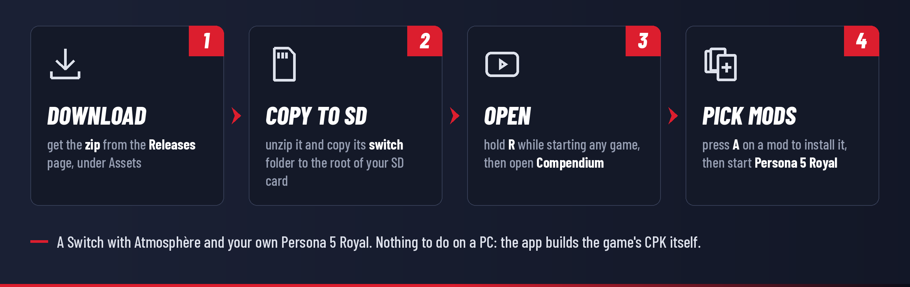

# Installing and using Compendium

[](INSTALL.md)
[](INSTALL.es.md)

[← Back to the README](../README.md)

> [!TIP]
> **New to Switch homebrew?** You first need a console that runs custom firmware (Atmosphère) with the Homebrew
> Menu. The community guide [switch.hacks.guide](https://switch.hacks.guide/) explains how, step by step. The
> words used on this page are explained in the [glossary](#glossary).

## What you need

- A Nintendo Switch, Switch OLED or Switch Lite running [Atmosphère](https://github.com/Atmosphere-NX/Atmosphere)
  with the Homebrew Menu. An **emuMMC** is the safer way to use mods.
- Your own **Persona 5 Royal** for Switch (title ID `01005CA01580E000`). Any version works with the default
  mode; the optional p5rcbt plugin needs version 1.0.2.
- Wi-Fi to browse and download mods (or a way to copy mod archives to the SD card).
- Free space on the SD card for your mods twice: the app keeps a copy of each, and builds the game's CPK from them.

Before you start, back up your saves (for example with [JKSV](https://github.com/J-D-K/JKSV)) and keep a copy of
your SD card. A broken or incompatible mod can crash the game; it can't harm the console, and turning mods off
always brings the game back to normal.

## Install



1. On the [Releases](../../../releases) page, under **Assets**, download **`Compendium-<version>.zip`**.
   ("Source code" is only for developers.)
2. Unzip it. Inside is a `switch` folder with everything in its place: `switch/Compendium/Compendium.nro`, a short
   guide (`README.txt`), the licenses and the empty `inbox` folder.
3. Copy that **`switch`** folder to the root of your SD card. It joins the `switch` folder already there, next to
   your other homebrew.
   - **On a Mac**, Finder replaces a folder instead of joining it, which would remove your other homebrew. There,
     open the zip's `switch` folder and copy just the **`Compendium`** folder into your SD card's `switch` folder.
   - Copying over USB with DBI (MTP) or over FTP works the same way.
4. Put the SD card back and turn the console on.

## Starting the app

Hold **R** while you start any game: the Homebrew Menu opens in place of the game. Choose **Compendium**.

> [!WARNING]
> Opened from the **Album**, homebrew gets much less memory. Compendium works there, but downloading or building
> large mods can run out of memory; the app says so when it happens. Use **R + a game** when you can.

At the first start, the app makes its folder (`switch/Compendium/`), checks your game version and shows the
**Browse** page. It doesn't change anything on the SD card until you install a mod.

## The game's own files (one-time step, recommended)

Persona 5 Royal's update comes with a `PATCH1.CPK` that holds some of the game's own files. In the default mode,
Compendium builds a new `PATCH1.CPK` with your mods; to keep the game's files in it too, the app has to read them
once:

1. Press **+** to close Compendium.
2. Hold **L and R** and start Persona 5 Royal. Keep holding until the Homebrew Menu opens.
   (R opens the Homebrew Menu in place of the game; L turns mods off for that launch, so the app sees the
   game's own files and not a modded copy.)
3. Open Compendium. It copies the game's `PATCH1.CPK` and its file list into `switch/Compendium/original/` and
   tells you when it's done.

Do it again after each game update. Until it's done, Settings shows **Not read yet**, and the CPK is built from
your mods alone, which works for most mods.

The file list also helps with mods that leave out their CPK folder (a lone `BTL_UI.PAK` instead of
`BASE/BATTLE/GUI/BTL_UI.PAK`): the app finds where the game keeps that file.

## Installing mods

**From GameBanana.** On **Browse**, **L / R** switch between Switch mods and PC mods, **Y** changes the order
(most downloaded, most liked, newest, recently updated) and **X** searches. Press **A** on a mod, then **A** on its file: the one
that fits your game version is marked **Matches your game**. **Search** finds mods by name or author, or by their
number (the end of the mod's GameBanana link: `gamebanana.com/mods/123456`).

**From your phone or computer.** On **Add mods → Send a link to this Switch**, scan the QR code with a phone on
the same Wi-Fi (or type the address shown into a browser) and paste a mod's link: a GameBanana page, a GitHub
project (its latest release is used) or a direct download link.

**From the SD card.** Copy `.zip`, `.7z`, `.rar` or `.cpk` files into `switch/Compendium/inbox/` (with a PC, or
over USB or Wi-Fi with DBI or sys-ftpd) and install them from **Add mods**. The file stays in the inbox after
installing; **X** deletes it.

**Mods you already have.** **Add mods** also lists mods kept for SimpleModManager (`sd:/mods/Persona 5 Royal/…`)
and a `PATCH1.CPK` you copied into `atmosphere/contents/01005CA01580E000/romfs/CPK/` by hand. Adding them puts
them in your list, so they're merged with your other mods instead of being replaced.

**Mods with options.** If an archive holds several versions or add-ons (folders with their own `Package.xml`, for
example), the app lets you pick: **A** ticks one, **+** installs the ones you picked.

Before installing, the app tells you if the mod changes files that one of your mods also changes, and which
parts it couldn't use (for example, `.flow` scripts that need Aemulus on a PC). Every new mod goes to the top of
the list, on.

## Load order and turning mods off

**My mods** is your load order. When two mods change the same file, the one higher in the list wins; mods that
clash are marked with ⚠, and the panel on the right says which files and what to do. **L** and **R** move the
selected mod up and down, **A** turns it on or off, **X** removes it (its copy in the library is deleted).

Every change builds the game's CPK again, so it always matches the list. To play once without any mods, hold
**L** while starting the game (that's Atmosphère's own switch, so it works even without the app).

## Settings

- **Load mods with:** PATCH1.CPK (the default, no plugin) or p5rcbt (the Skyline plugin, game version 1.0.2).
  Switching moves your mods from one to the other.
- **The game's own files:** whether they were read, and how.
- **p5rcbt:** install it from GitHub, and change its options (60 FPS, the PC version's settings menu, logging).
- **Background add-ons:** the sysmodules in `atmosphere/contents`, which ones are known, and turning them off.
  They start when the console boots, so changes apply after a restart.
- **Storage** and **Build the game's mod files again** (a repair, if the SD card was changed by hand).

## The app's folder

```
sd:/switch/Compendium/
├── Compendium.nro     the app
├── README.txt         a short guide (from the zip)
├── LICENSES.txt       Compendium's license and the third-party notices (from the zip)
├── library/p5r/<mod>/ a copy of every installed mod: files/, cpk/ and sd/
├── inbox/             archives to install from Add mods
├── original/p5r/      the game's own PATCH1.CPK and file list
├── backup/            files that were on the SD card where the app writes (put back later)
├── settings.json      the app's settings
├── state.json         what's installed, the load order and what was built
└── log.txt            what the app did and any errors (log.old.txt is the one before)
```

And the files it builds:

| Mode | File |
|---|---|
| PATCH1.CPK (default) | `atmosphere/contents/01005CA01580E000/romfs/CPK/PATCH1.CPK` |
| p5rcbt | `p5r/bind/Compendium.cpk` (and p5rcbt itself in `atmosphere/contents/01005CA01580E000/exefs/` and `romfs/skyline/plugins/`) |

Mods with cheats, exefs patches or Skyline plugins also put those in `atmosphere/contents/01005CA01580E000/`.

## Updating

Copy the new zip's `switch` folder over the old one, as when installing (or just replace `Compendium.nro`). Your
library, load order and settings are kept. After a **game**
update, do the [one-time step](#the-games-own-files-one-time-step-recommended) again.

## Removing Compendium

Turn every mod off (or remove them) in **My mods**: the app deletes the CPK it built and puts back the files it
had set aside. Then delete `switch/Compendium/`.

## Troubleshooting

| Message or problem | What to do |
|---|---|
| **"Install failed: filesystem error: cannot make canonical path"** | A bug of 0.0.1 on the Switch: update to 0.0.2 or newer. Mods it already downloaded install without downloading again. |
| **A mod doesn't show in the game** | Check it's on in **My mods** and above any mod marked ⚠ that changes the same files. Make sure you didn't hold **L** when starting the game. Then **Settings → Build the game's mod files again**. |
| **The game crashes or freezes at start after installing a mod** | Turn off the mods you added last, one at a time, to find the one. Check its page: some mods are for another game version, or for the PC version only. Hold **L** while starting the game to check it works without mods. |
| **Atmosphère error with Program ID 010041544D530000** | Atmosphère ran out of memory while loading mods. That's usually background add-ons (sysmodules), not the mod: turn them off in **Settings → Background add-ons**, restart the console and try again. The app shows this when it finds the crash report. |
| **"Couldn't reach GameBanana" / secure connection errors** | Check the console's date and time (a wrong date breaks secure connections), then the Wi-Fi. A DNS blocker that also blocks GameBanana gives the same error. |
| **"Compendium ran out of memory"** | It was opened from the Album. Close it with **+**, hold **R** while starting a game and open it from the Homebrew Menu that appears. |
| **"There isn't enough space on the SD card"** | The app checks before it writes anything. Free some space, or remove mods you don't use. |
| **"Can't install this file"** | The app couldn't find game files in it (a mod for another game, or a tool rather than a mod). The message says what it found. If you think it's a P5R mod, please [report](#reporting-a-bug) it with the link. |
| **"This is a save file, not a mod"** | Save files (`DATA01/DATA.DAT`…) go in the game's save data, not in its files: copy them with a save manager such as [JKSV](https://github.com/J-D-K/JKSV), after backing up your own save. |
| **p5rcbt mode does nothing** | p5rcbt needs game version 1.0.2; check it's installed (Settings) and on in My mods. |
| **The phone can't open the address** | Phone and Switch must be on the same Wi-Fi, not a guest network that isolates devices. The address works only while the screen is open. |
| **The game's own files say "Not read yet"** | Do the [one-time step](#the-games-own-files-one-time-step-recommended): hold **L and R** while starting the game, keep holding until the Homebrew Menu opens, then open Compendium. |

## Reporting a bug

Use the [bug report form](../../../issues/new/choose) (English or Spanish), and attach
`switch/Compendium/log.txt` (and `log.old.txt` if the problem was in an earlier session). If the game or the app
crashed with an Atmosphère error, the newest file in `atmosphere/crash_reports/` helps too. Include the links to
the mods involved. Please never attach game files.

## Glossary

| Word | What it means |
|---|---|
| **Atmosphère** | The custom firmware that lets a Switch run homebrew and load mods. |
| **emuMMC** | A copy of the Switch's system on the SD card, used to run custom firmware without touching the console's own system. The safer way to use homebrew and mods. |
| **Homebrew Menu** | The menu that lists and starts homebrew apps (`.nro` files). |
| **Title takeover** | Opening the Homebrew Menu by holding **R** while starting a game, so homebrew gets all the memory a game gets. |
| **LayeredFS** | Atmosphère's way of loading mods: files in `atmosphere/contents/<title ID>/romfs/` are used in place of the game's own. |
| **CPK** | CRI's archive format. Persona 5 Royal keeps its files in CPKs (`ALL_USEU.CPK`, `PATCH1.CPK`…); its mods go in a `PATCH1.CPK`. |
| **Aemulus** | The PC mod manager for Persona games. Most P5R Switch mods are Aemulus packages (a folder with `Package.xml`). |
| **Reloaded-II** | The PC mod loader used by the PC version of P5R. Its mods have a `ModConfig.json`. |
| **p5rcbt** | A Skyline plugin by Raytwo that adds CPKs to P5R's files without replacing PATCH1.CPK, with a 60 FPS option. Game version 1.0.2 only. |
| **Skyline** | A code-injection framework for Switch games that loads plugins. |
| **Sysmodule** | A homebrew program that runs in the background from boot (sys-clk, MissionControl, ldn_mitm…). |
| **SimpleModManager** | Another Switch mod manager, which keeps mods in `sd:/mods/<game>/<mod>/`. |
| **Load order** | The order of your mods: when two change the same file, the one higher in the list wins. |
